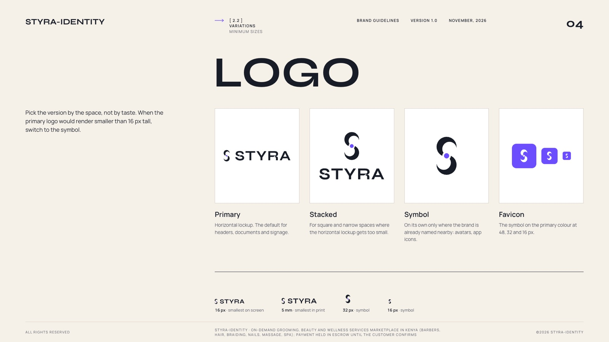

# Styra identity kit

Chosen direction: **Concept A, "Signature"**. This kit is a proposal for review; nothing in the app uses it yet.



## Decision

| | |
|---|---|
| **Pick** | Concept A, Signature (of four concepts: A Signature, B Collective, C Experience, D Discovery) |
| **Decided by** | The agent. The user delegated every decision ("I leave all decisions to you") and reviews on the PR. |
| **Date** | 2026-11-20 |
| **Why** | It is the only concept that passes the monochrome test and the 16 px test while still telling you what Styra is. The S is drawn as two scissor blades crossing at a pivot, so it reads as grooming, as movement, and as the point where customer and professional meet. None of it depends on colour. |
| **Rejected** | **C (Experience):** four forms around a centre point read as a flower or spark, the spa cliché the brief rules out. **D (Discovery):** a map pin is the most literal concept, and its S disappears at 16 px. **B (Collective):** a split mirror holding a drop; the drop reads as spa or water, and the split ring reads as a refresh icon. |
| **Supersedes** | "Held Point", an earlier two-set run judged too minimal. It is not in this kit. |

Concept sheet (monochrome and 16/32 px tests): `concepts/concept-sheet.jpg`. Full comparison board: `concepts/board.jpg`.

## The system

1. **Symbol:** two crescent blades form an S and cross at a pivot. The pivot is the only colour (violet), separated from the blades by a gap, so the mark still reads in one colour.
2. **Wordmark:** STYRA in uppercase **Syne** 700, tracked +40. The S and R each carry one custom cut at −35°, the blades' angle, through the S spine and the R leg join.
3. **App icon:** an ivory symbol on graphite, with a violet pivot. A heavier drawing (`monogram`) takes over at 16–48 px.

Lockups: `horizontal`, `stacked`, `symbol`, `monogram` (small-size symbol) and `wordmark`, each in `color-light`, `color-dark` (reversed), `mono-black` and `mono-white`. That gives 20 SVGs in `logo/`. The outlines come from Syne under OFL-1.1, so no font is needed to display the logo.

- **Clear space:** one cap height of the wordmark on every side.
- **Minimum size:** the symbol is 16 px (5 mm) with the `monogram` drawing; the horizontal lockup is 24 px high.
- **Misuse:** don't stretch, rotate or add effects. Don't fill the gap around the pivot, and don't move the pivot off the blades.

## Type (2 Google Fonts, both OFL)

| Role | Family | Why |
|---|---|---|
| Display / wordmark | **Syne** 700, uppercase | A wide, editorial and slightly futuristic face; distinctive without decoration |
| Text / UI | **Manrope** 400 / 600 / 700, `tnum` | Clear at small sizes, has tabular figures for prices and times, and covers French and Swahili accents |

Neither is Inter or Poppins. The embed snippet is in `tokens/fonts.css`.

## Colour

| Token | Light | Dark | Use |
|---|---|---|---|
| Background | Ivory `#F5F0E8` | Graphite `#121318` | page |
| Surface | `#FFFFFF` | `#171C26` | cards, sheets |
| Text | `#171C26` (15.0:1 on ivory) | `#F2F3F5` (16.7:1) | body |
| Primary / accent | Violet `#6C4EFF` (white text 5.0:1) | `#8780FD` (dark text 6.0:1) | primary actions, the pivot, highlights only |
| Gradient end | Electric blue `#2F7BFF` | same | violet→blue gradient on primary buttons and highlights only, never in the logo |
| Neutral | Silver `#B8BDC7` | same | dividers, icons |

**Status colours** (bluish-green, amber, vermilion, blue) are kept apart from the violet accent and stay distinct under the common types of colour blindness. Always pair them with an icon or label.

| Status | Light | Dark |
|---|---|---|
| Success | `#08795E` (4.7:1) | `#3FC6A0` |
| Warning | `#8F5A06` (5.1:1) | `#E59B37` |
| Danger | `#B4312B` (5.4:1) | `#FE8477` |
| Info | `#196AAF` (5.0:1) | `#66B2FD` |

The light-theme violet link is under 3:1 against body text, so **links are always underlined**.

The AI-default flags from the brand tool are justified: you asked for the ivory ground and the violet accent.

## Files

```
brand/
  logo/          20 SVGs: horizontal, stacked, symbol, monogram, wordmark × colour-light/colour-dark/mono-black/mono-white
  tokens/        tokens.css (light + dark, data-theme and prefers-color-scheme), tailwind.palette.js, tokens.dtcg.json, fonts.css
  icons/ios/     AppIcon-1024.png (opaque, no transparency)
  icons/android/ res/: adaptive icon (foreground, background, themed monochrome) as vector drawables
  icons/web/     favicon.ico (16/32/48), favicon.svg (adapts to dark mode), apple-touch-icon.png (180), icon-maskable-512.png
  social/        og-image-1200x630.png
  guidelines/    styra-identity-guidelines.pdf (13 pages)
  concepts/      concept sheet, comparison board, logo system
```

The kit was made with the `brand-identity` skill (fatihaydost/brand-identity-skill), measured with its audits and judged by eye at 16 and 32 px. Higgsfield was not used.
